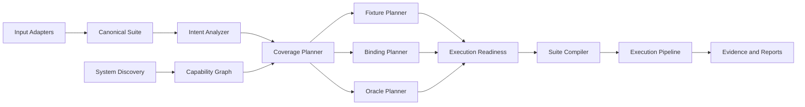

# Framework Architecture



The stable contracts live in `core/framework.py`. Business facts are assets in
profiles, connectors, capability packs, suite-local bindings, fixture recipes,
or oracle configuration. The framework layer must not import a concrete suite.

`python run_onboard.py onboard --cases <file> --profile <profile> --workspace <workspace>`
runs the full planning pass before execution. Every imported case receives a
readiness record, and every missing required layer receives a structured gap.

To execute, provide a suite directory containing approved canonical execution
bindings and use the explicit intersection gate:

```powershell
python run_onboard.py onboard `
  --cases <file> `
  --profile <profile> `
  --suite-assets <approved-suite> `
  --workspace <workspace> `
  --execute-ready
```

Only cases that are `READY` in the new onboarding output and
`EXECUTION_READY` in the approved canonical suite are sent to the existing
pipeline. Cases missing either gate remain in the onboarding report.

Each onboarding run also emits `gap_resolutions.template.yaml`. Business or
environment owners fill this file, mark individually reviewed entries as
`approved`, identify `approved_by`, and provide the requested configuration.
Re-run onboarding with `--resolutions <reviewed-file>` to recalculate readiness.
Pending or rejected answers never clear a gap, and acknowledging a
`MANUAL_ONLY` item never makes it automation-ready.
