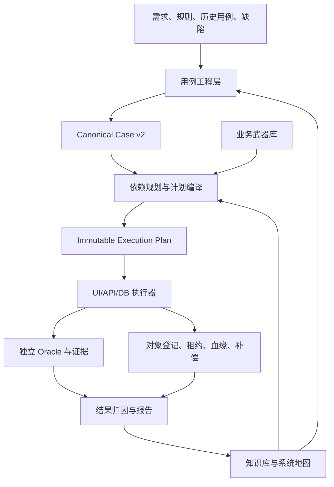

# Crosscheck 用例工程 × 业务武器库统一实施方案

> 版本：v1.0 · 目标评分：≥9.5/10 · 状态：讨论稿 · 适用链路：需求 → 策略 → 招采 → 合同 → 订单

## 1. 执行摘要

Crosscheck 下一阶段不应把“用例”和“武器库”作为两个独立项目建设。二者共同组成一条可执行业务链：

```text
需求/规则
  → 可执行用例：说明测什么、需要什么、怎样算对
  → 依赖规划器：判断缺少哪些业务对象和状态
  → 业务武器库：查询、创建、推进、维护、清理依赖数据
  → 确定性执行器：执行 UI/API/DB 动作
  → 独立判定：UI/API/DB/事件证据
  → 血缘、报告、补偿、知识回流
```

统一方案的核心不是“让 AI 自动点页面”，而是建立一个边界清晰的系统：

- AI 负责理解、设计、发现缺口和推荐方案；
- 人负责确认业务真相、风险和不可逆边界；
- canonical 用例负责表达测试意图和判定标准；
- 武器能力负责稳定准备业务依赖；
- 编译器负责把二者生成不可变计划；
- 执行器负责确定性执行、证据和补偿；
- 登记册负责对象、租约、血缘、恢复和审计。

最终目标是：业务人员不需要写自动化代码，测试人员不需要重复手工造数，AI 不需要猜业务真相，执行器不需要理解自然语言。

## 2. 目标、非目标和成功标准

### 2.1 目标

1. 将自然语言、Excel、需求和规则转换为可审计的可执行用例。
2. 将“存在已审批需求”等前置条件转换为可规划的业务对象需求。
3. 从已批准武器中选择查询、创建、状态推进、维护和补偿能力。
4. 支持需求 → 策略 → 招采 → 合同 → 订单逐段累加。
5. 将上游对象 ID、编号、状态和证据可靠传给下游。
6. 正确区分规格失败、前置失败、环境失败、能力漂移、目标失败和清理失败。
7. 所有写操作可追踪、可限界、可恢复、可补偿或明确人工接管。

### 2.2 非目标

- 不追求 AI 无人审核地生成正式 READY 用例。
- 不允许 AI 生成任意 SQL 或绕过业务流程制造被测结果。
- 不在第一期覆盖所有业务节点、所有租户和所有数据库。
- 不把一次 UI 录制直接视为长期稳定的正式能力。
- 不用页面提示或单一 API 响应代替独立业务判定。

### 2.3 成功标准

第一阶段成功必须同时满足：

- 一条结构化用例能声明“已审批需求”前置条件；
- 系统能创建或选择合格需求；
- 系统能获取稳定的 `requirement.id/code/status`；
- 前置失败不会误报为下游业务 FAIL；
- 重试不会重复造单；
- 清理/取消失败会被登记和熔断；
- 全过程有计划 hash、能力 hash、环境指纹、血缘和证据。

## 3. 系统分层



### 3.1 用例工程层

负责测试点、结构化用例、来源追踪、歧义检查、覆盖分析和人审。

### 3.2 武器库层

负责业务对象查询、创建、推进状态、受控维护、补偿和清理。

### 3.3 计划编译层

把用例和能力依赖闭包编译为不可变计划，绑定全部版本、哈希和环境指纹。

### 3.4 执行层

只执行计划，不理解散文，不临场调用 LLM 修改步骤和断言。

### 3.5 运行控制层

负责对象登记、租约、步骤 checkpoint、恢复、熔断、血缘、审计和人工接管。

## 4. 统一领域模型

### 4.1 需求与规则

每条业务事实必须具有稳定 ID、来源和状态：

```yaml
rule_id: RULE-STRATEGY-007
statement: 只有已审批需求可以发布策略
source: PRD-123#4.2
status: approved
owner: purchasing-product
effective_from: 2026-01-01
```

AI 推测只能进入 `candidate`，不能作为正式断言。

### 4.2 可执行用例

一条用例只有一个主要 `under_test`，前置链路不计入目标节点判定：

```yaml
case_id: strategy-publish-001
traceability:
  requirements: [PRD-123]
  rules: [RULE-STRATEGY-007]
intent:
  under_test: strategy.publish
preconditions:
  - ref: requirement
    object: requirement
    state: APPROVED
    strategy: create
    conditions:
      amount: {gte: 100000}
action:
  capability: strategy.publish
  inputs:
    requirement_id: "{{ requirement.id }}"
oracles: []
```

### 4.3 业务对象

```yaml
object_type: requirement
identity:
  id: "12345"
  code: REQ-20261113-001
state: APPROVED
attributes:
  amount: 100000
  department: purchasing
provenance:
  created_by_run: run-001
  capability: requirement.create@1.0.0
```

### 4.4 武器能力

```yaml
capability_id: requirement.create
version: 1.0.0
requires: {}
provides:
  object: requirement
  state: DRAFT
effects:
  mutates: true
  reversibility: compensatable
execution:
  mode: ui
evidence:
  required: [ui, api, db]
compensation:
  capability: requirement.cancel
```

### 4.5 执行计划

计划包括：

- 用例和断言；
- 能力依赖 DAG；
- 输入和输出变量绑定；
- actor/session 绑定；
- 风险和审批；
- 证据与等待策略；
- 补偿 DAG；
- 所有依赖内容哈希和环境指纹。

## 5. 用例工程设计

### 5.1 用例最小完整集

业务层必须回答：

1. 测哪个业务动作；
2. 谁执行；
3. 需要什么对象和状态；
4. 哪些关键条件影响结果；
5. 成功和失败分别是什么；
6. 有哪些副作用；
7. 如何清理或补偿；
8. 规则来自哪里。

业务层不必提供定位器、SQL 和 JSONPath。

### 5.2 结构化 Oracle

禁止使用“成功、正常、正确、合理”等无法判定的预期。统一表达：

```yaml
- id: A-REL-001
  subject: strategy.requirement_id
  operator: equals
  expected: "{{ requirement.id }}"
  business_meaning: 策略必须关联本次需求
  proof_candidates: [api, db]
```

业务断言与实现 proof 分离。系统换表、换接口时，可以重绑 proof，而不改业务含义。

### 5.3 用例状态

```text
INCOMPLETE
→ DESIGN_READY
→ BINDING_READY
→ EXECUTION_CANDIDATE
→ READY
→ RETIRED
```

- `DESIGN_READY`：业务事实完整；
- `BINDING_READY`：可以探测并绑定执行证据；
- `EXECUTION_CANDIDATE`：绑定完整，等待人审；
- `READY`：审批和哈希绑定，可执行。

### 5.4 AI 的使用方式

AI 负责：

- 从 PRD、源码、接口、数据库、历史用例抽取事实；
- 为每条事实保留来源；
- 生成测试点和 draft；
- 检测含糊词、冲突、遗漏和重复；
- 提出最少的阻塞问题；
- 推荐能力和 proof 绑定。

AI 不负责：

- 无来源地决定业务规则；
- 自动批准正式用例；
- 修改预期以适应失败结果；
- 在正式执行时临场改变动作。

### 5.5 测试设计组合

每个关键动作按风险选择：

- 正常路径；
- 状态非法；
- 角色/组织/租户权限；
- 必填、格式、边界和组合；
- 重复提交和幂等；
- 异步超时和恢复；
- 上下游关联；
- 审计、副作用和补偿。

采用 pairwise、风险优先级和代表值削减组合，避免用例数量爆炸。

## 6. 武器库设计

### 6.1 能力类型

```text
find       查找并 claim 现有对象
create     创建对象
transition 推进状态
maintain   受控补齐字段/关系
verify     独立确认状态和关联
compensate 取消、失效、冲正或删除
```

### 6.2 查询、创建和维护策略

用例显式声明：

```yaml
strategy: create
strategy: find
strategy: find_or_create
```

- 正式写操作默认 `create`；
- 只读或高成本前置可按政策使用 `find_or_create`；
- `find` 必须原子 claim，不能先查询后无锁使用；
- DB maintain 不能替代当前 `under_test` 的真实业务动作。

### 6.3 能力健康度

每个能力记录：

- owner；
- 最近认证时间；
- 适用系统版本和环境；
- 页面/API 指纹；
- 最近成功率和漂移率；
- 当前 `healthy/degraded/unhealthy/retired` 状态。

规划器不自动选择 `unhealthy` 能力。

### 6.4 安全模型

安全判断基于副作用，不基于执行通道：

- UI 提交、API POST、DB UPDATE 都可能是写操作；
- 所有写能力需要非生产指纹、审批、行/对象范围、独立验证和补偿；
- DB 操作只接受受控模板、参数和白名单；
- 禁止任意 SQL；
- 不可逆能力必须显式人工确认和责任人。

## 7. 依赖规划器

### 7.1 输入

- 用例 preconditions；
- 当前对象登记册；
- 已批准且健康的能力；
- 环境、角色和政策；
- 最大成本、深度、风险和耗时预算。

### 7.2 规划流程

1. 将前置条件标准化为对象约束。
2. 检查已有对象并原子 claim。
3. 对状态不足对象寻找合法 transition。
4. 对字段不足对象寻找 maintain；高风险维护需要显式授权。
5. 不存在对象时选择 create。
6. 递归展开能力 requires。
7. 检查循环、冲突、角色、环境、时间和预算。
8. 为每个输出建立变量绑定。
9. 生成正向执行 DAG 和逆向补偿 DAG。
10. 计算完整依赖闭包 hash 并等待审批。

### 7.3 方案选择函数

候选方案按以下顺序评价，而不是由模型随机选择：

```text
测试真实性 > 安全 > 可恢复性 > 数据隔离 > 稳定性 > 时间成本
```

每次选择都记录理由。例如测试策略页面时，不能因为 DB 造数更快就绕过 `strategy.publish`。

## 8. 执行、恢复与补偿

### 8.1 步骤状态

```text
not_started
running
succeeded
failed
unknown
compensating
compensated
manual_required
```

### 8.2 幂等和 unknown

每个写步骤必须声明：

- idempotency key；
- 远端反查方法；
- 可重试错误；
- 不可重试错误；
- 超时后的确认流程。

请求超时不能直接重试。先进入 `unknown`，反查远端是否已经成功。

### 8.3 对象登记册

使用事务存储，至少包含：

```text
runs, plans, capabilities, objects, leases,
lineage, steps, evidence, cleanup_tasks, audit_events
```

普通 JSON 文件只可用于导出，不作为并发和恢复的事实源。

### 8.4 补偿

补偿类型：

```text
delete, cancel, invalidate, reverse, manual, none
```

补偿按子到父逆拓扑执行。业务 PASS 与清理状态分别报告；清理失败不能悄悄忽略。

## 9. 独立判定与失败归因

### 9.1 独立判定

- UI 创建 → API/DB 验证；
- API 创建 → DB/UI 验证；
- DB 准备 → API/业务查询验证。

不得用同一个写请求的返回值作为唯一成功证据。

### 9.2 失败分类

```text
SPEC_ERROR
PLAN_ERROR
SAFETY_BLOCKED
PREREQUISITE_FAILED
ENV_ERROR
CAPABILITY_DRIFT
TARGET_FAIL
UNKNOWN
CLEANUP_FAILED
```

只有 `TARGET_FAIL` 表示当前 `under_test` 的业务失败。其他失败独立统计并提供下一步。

## 10. 逐段实施路线

### Stage 0：共同契约和底座

- Case v2、Capability v1、Object v1、Plan v1 schema；
- 规则和来源模型；
- 环境指纹、副作用政策和失败分类；
- 事务登记册和步骤级 checkpoint；
- v1 用例迁移器和静态审计器。

### Stage 1：需求场景

```text
requirement.create
requirement.find
requirement.submit
requirement.approve
requirement.verify
requirement.cancel/cleanup
```

先通过节点测试，再通过需求累计链路。

### Stage 2：需求 + 策略

新增 `strategy.publish/verify/cancel`，完成 1+2 链路。

### Stage 3：需求 + 策略 + 招采

新增招采能力和跨角色、异步事件等待，完成 1+2+3。

### Stage 4：合同

重点处理不可逆副作用、电子签、外部同步和人工接管。

### Stage 5：订单

重点处理金额、数量、幂等、库存/预算关联和外部订单副作用。

每阶段保留：节点测试、累计链路测试、失败注入、并发测试、补偿测试和回归测试。

## 11. 开发工作包

### WP-01 Schema 与迁移

交付：四类 schema、v1→v2 迁移器、正反例 fixtures、schema 测试。

### WP-02 用例审计器

交付：歧义、缺失、重复、覆盖、来源和可执行性报告。

### WP-03 规则和知识闭环

交付：事实来源、open questions、审批、冲突和 stale 管理。

### WP-04 武器注册表

交付：能力加载、版本、健康度、审批和策略过滤。

### WP-05 规划编译器

交付：依赖 DAG、变量绑定、选择理由、计划 hash 和补偿 DAG。

### WP-06 事务运行时

交付：登记册、租约、步骤状态、恢复、熔断和人工接管。

### WP-07 需求能力包

交付：需求 create/find/submit/approve/verify/compensate。

### WP-08 策略能力包

交付：策略 publish/verify/compensate 和 1+2 链路。

### WP-09 报告与治理

交付：失败归因、血缘图、残留队列、能力健康、审计和脱敏。

## 12. 统一检查点

### G0：范围和事实

- [ ] 对象、状态机、角色、权限、环境和副作用已确认；
- [ ] 业务规则有稳定 ID 和 owner；
- [ ] 未决问题有阻塞范围和负责人。

### G1：契约

- [ ] Case/Capability/Object/Plan schema 冻结；
- [ ] v1 用例迁移不丢失来源；
- [ ] 含糊预期、无来源规则、未知状态会被拒绝。

### G2：安全和运行时

- [ ] 生产/未知环境写操作必拒绝；
- [ ] UI/API/DB 副作用统一门禁；
- [ ] 事务登记册、租约、unknown 和恢复测试通过；
- [ ] 敏感信息不进入日志、计划和证据。

### G3：需求节点

- [ ] 离线 mock 测试通过；
- [ ] 真实创建连续三次成功；
- [ ] 超时、重复提交、清理失败和角色错误测试通过；
- [ ] 零未解释残留和越权变化。

### G4：1+2 链路

- [ ] 需求输出稳定注入策略；
- [ ] 前置失败不记策略 FAIL；
- [ ] 血缘和补偿顺序正确；
- [ ] 节点测试和累计链路测试都通过。

### G5：正式发布

- [ ] 运行手册、故障手册、威胁模型和发布清单齐全；
- [ ] 总开关、熔断、残留告警和人工接管可用；
- [ ] 所有 gate 生成结构化报告并由责任人签署。

## 13. 指标体系

### 13.1 用例质量

| 指标 | 目标 |
|---|---:|
| 一次业务澄清后达到 BINDING_READY | ≥70% |
| 无来源规则进入 READY | 0 |
| 需求/规则到用例追踪率 | ≥95% |
| 含糊预期进入 READY | 0 |

### 13.2 执行质量

| 指标 | 目标 |
|---|---:|
| READY 用例首次执行成功率 | ≥85% |
| 自动失败归因率 | ≥90% |
| 前置失败误报 TARGET_FAIL | 0 |
| unknown 被盲目重试 | 0 |

### 13.3 武器质量

| 指标 | 目标 |
|---|---:|
| 已认证能力成功率 | ≥95% |
| 并发对象冲突 | 0 |
| 未登记写操作 | 0 |
| 未解释残留对象 | 0 |
| 能力漂移自动识别率 | ≥90% |

### 13.4 效率

| 指标 | 目标 |
|---|---:|
| 单条用例人工补齐耗时 | 下降 50% |
| 前置数据准备耗时 | 下降 60% |
| 重复页面造数操作 | 下降 70% |
| 失败定位平均时间 | 下降 50% |

## 14. 关键决策记录

1. 正式执行期不调用 LLM 改写计划。
2. 一条用例只有一个主要 `under_test`。
3. 业务断言与 UI/API/DB proof 分离。
4. 前置条件对象化，并由武器库满足。
5. 写入风险按副作用判定，不按执行通道判定。
6. DB maintain 不能替代当前被测动作。
7. unknown 必须反查，不能盲目重试。
8. 登记册使用事务存储，不使用普通 JSON 作为事实源。
9. 节点测试和累计链路测试同时保留。
10. 先需求，再 1+2，再 1+2+3，未通过 gate 不扩展。

## 15. 仍需共同确认的问题

这些问题必须在 G0 或对应阶段解决：

1. 需求创建后是否允许物理删除，还是只能取消/作废？
2. 审批是否需要两个不同账号，是否存在组织/金额审批矩阵？
3. 哪个状态才允许策略发布，是否允许部分需求或拆分发布？
4. 策略与需求是一对一、一对多还是多对多？
5. 招采、合同、订单是否有外部系统、消息和电子签副作用？
6. 是否存在专用测试租户、测试组织和数据命名空间？
7. 数据库写账号允许哪些表、字段、行范围和最大影响行数？
8. 哪些业务动作严格禁止 DB 维护，只能通过 UI/API？
9. 测试数据保留多久，谁处理长期 orphan 和 manual_required？
10. 业务规则、能力和用例分别由谁担任 owner 和审批人？

## 16. 评分与审计

### 16.1 方案自评分：9.6/10

| 维度 | 权重 | 得分 | 说明 |
|---|---:|---:|---|
| 业务完整性 | 20% | 19 | 用例、依赖、状态、角色、断言和补偿贯通 |
| 架构清晰度 | 15% | 15 | AI、用例、武器、编译器、执行器边界清晰 |
| 可落地性 | 20% | 19 | 基于现有 canonical、knowledge、adapter、cleanup 增量建设 |
| 安全与恢复 | 15% | 15 | 环境指纹、租约、unknown、幂等、补偿和熔断完整 |
| 可测试性 | 15% | 14 | 有工作包、gate、指标和失败注入；真实环境仍待验证 |
| 演进与维护 | 15% | 14 | 逐段扩展、版本、健康度和 owner 完整；治理成本需实践 |
| **总分** | **100%** | **96/100** | **达到 9.5 分目标** |

### 16.2 为什么不是 10 分

以下内容必须通过真实环境验证，不能靠方案文字获得满分：

- 页面定位和接口契约的真实稳定性；
- 多角色审批和登录态切换；
- MQ/定时任务等异步链路；
- 不可逆业务动作的真实补偿能力；
- 并发租约在真实压测下的可靠性；
- 业务资料质量和 owner 响应速度。

### 16.3 独立验收建议

开发完成后，不由实现者单独宣布完成。由业务、测试、开发/平台、安全四方分别验收：

- 业务：规则、状态和结果是否真实；
- 测试：覆盖、断言和失败归因是否正确；
- 平台：计划、执行、恢复、并发和报告是否可靠；
- 安全：环境、权限、秘密、DB 写入和副作用是否受控。

## 17. 下一步会议建议

下一次讨论不要继续泛化设计，直接审查以下五份输入：

1. 需求对象状态机；
2. 需求创建和审批角色矩阵；
3. 一条真实“发布策略”用例；
4. 一次真实需求创建录制/抓包/数据库变化；
5. 需求的清理或取消政策。

基于这五份输入完成 G0，并冻结第一批 schema 和 `requirement.create` 能力边界，然后正式进入开发。

## 18. 开工前冻结原则

以下原则从开工之日起作为硬门禁。后续实现、测试、报告和验收如与本节冲突，以本节为准；变更必须形成书面决策记录并由项目负责人批准。

### 18.1 原则一：承诺范围内自测必须 100% 通过

“完成”不等于代码已写、主流程跑通或大部分测试通过。一个小功能只有同时满足以下条件，才可以标记完成：

1. 该功能的验收标准已经书面化；
2. 正向、负向、边界、权限、幂等、异常和恢复场景按风险完成设计；
3. 与该功能直接相关的自动化测试全部通过；
4. 所属阶段的回归测试全部通过；
5. 安全、清理、证据、失败归因和兼容性门禁全部通过；
6. 没有被隐藏、跳过或改成预期失败的必测项；
7. 没有未解释的残留数据、未知状态和越权副作用；
8. 检查点报告和证据完整。

发布口径：

```text
功能验收通过数 / 功能验收总数 = 100%
自动化测试通过数 / 应执行测试总数 = 100%
安全门禁通过数 / 应执行门禁总数 = 100%
清理或已批准补偿完成数 / 应处理对象总数 = 100%
```

任何一项未达到 100%，该功能状态只能是 `IN_PROGRESS`、`BLOCKED` 或 `FAILED`，不能是 `DONE`。

#### 18.1.1 100% 的边界

这里的 100% 指“当前承诺范围和已定义验收集合全部成功”，不表示证明软件不存在任何未知缺陷，也不表示追求没有边界的全组合穷举。为了防止通过缩小测试集制造虚假 100%，必须同时满足：

- 功能开始开发前冻结验收清单和风险清单；
- 新发现的合理必测场景必须加入清单，不能为了数字好看排除；
- 测试跳过、隔离和豁免必须有原因、owner、到期时间和批准人；
- `SKIP`、`XFAIL`、`ENV_ERROR`、`UNKNOWN`、`CLEANUP_FAILED` 不计为成功；
- flaky 用例重跑通过不能直接计为成功，必须定位原因并达到规定稳定性；
- 外部环境不可用时功能状态为 `BLOCKED`，不是通过也不是业务失败。

#### 18.1.2 分层 100% 门禁

每个小功能依次通过：

```text
契约测试 100%
→ 单元测试 100%
→ 组件/适配器测试 100%
→ 离线集成测试 100%
→ 安全和故障注入 100%
→ 真实环境节点测试 100%
→ 所属累计链路回归 100%
```

如果功能不涉及某一层，必须在验收清单中明确标记 `NOT_APPLICABLE` 和理由，而不是静默不测。

#### 18.1.3 稳定性要求

- 纯确定性离线测试：连续执行 10 次，100% 通过；
- 真实 UI 节点：在环境稳定前提下连续执行至少 5 次，100% 通过；
- 写入、恢复和补偿路径：至少完成一次故障注入并成功恢复；
- 并发能力：按设计并发度执行，不能出现重复 claim、重复造数或血缘错乱；
- 页面/API 漂移造成的失败必须归为 `CAPABILITY_DRIFT`，修复并重新认证后才能放行。

#### 18.1.4 禁止为了 100% 做的事情

- 删除失败测试或放宽业务断言；
- 只验证页面提示，不验证真实业务状态；
- 把失败改成 `SKIP/XFAIL` 后宣布完成；
- 通过 DB 直接制造当前被测动作的成功结果；
- 只跑单节点，不跑所属累计链路；
- 忽略清理失败、unknown 或未登记副作用；
- 依赖无限重试掩盖 flaky。

### 18.2 原则二：AI 成功操作 UI 后必须沉淀资产

AI 完成一次 UI 操作后，不能只留下聊天记录或录像。只要该操作未来可能复用，就必须进入“捕获—归纳—验证—审批—发布”流程。

```text
一次 UI 操作
  → 原始捕获
  → 语义动作草稿
  → 业务事实/规则候选
  → 用例候选 + 武器候选
  → 回放和独立验证
  → 人工审批
  → 发布为正式资产
```

#### 18.2.1 是否每次都创建一个 Skill

不是每次都创建独立的顶层 Codex Skill。应按资产类型分别沉淀：

| 资产 | 用途 | 示例 |
|---|---|---|
| 原始捕获 | 保留页面、动作、请求和响应事实 | 录屏、trace、HAR、截图 |
| 语义动作配方 | 确定性回放页面操作 | 打开需求页、填写金额、提交 |
| 武器能力 | 准备、推进、验证或补偿业务对象 | `requirement.create` |
| 用例模板/候选 | 表达测试目标和业务断言 | 已审批需求发布策略 |
| 知识条目 | 保存已确认规则和字段含义 | 已审批需求才可发策略 |
| Skill | 让 AI 检索、选择、生成和维护上述资产 | 业务流程构建 Skill |

建议保持少量稳定的顶层 Skill，例如：

- `business-flow-builder`：从一次成功操作生成候选资产；
- `case-engineer`：生成和审计可执行用例；
- `arsenal-planner`：检索武器并生成依赖计划；
- `capability-maintainer`：处理页面/API 漂移和能力再认证。

具体的“创建需求”“审批需求”“发布策略”不必各写一个长篇自然语言 Skill，而应主要成为结构化、版本化、可审批的武器能力。顶层 Skill 负责发现和调用这些能力。

#### 18.2.2 一次 UI 操作可以同时给用例和武器库提供参考

可以，而且应该同时提供，但两者使用的信息不同：

**给用例工程的参考：**

- 用户目标和操作角色；
- 页面字段、必填项、枚举和校验提示；
- 正常和异常路径；
- 页面成功提示和可见状态；
- 候选业务断言；
- 需要进一步确认的业务规则。

**给武器库的参考：**

- 稳定入口和语义定位器；
- 操作步骤和等待点；
- 实际网络请求、响应和动态参数；
- 业务 ID、编号和状态的捕获方式；
- 上游输入和下游输出；
- 独立验证方法；
- 清理、取消或补偿方法；
- 页面/API 指纹和适用版本。

同一次捕获可以生成两个候选物：

```text
candidate case：验证需求创建规则和结果
candidate capability：requirement.create
```

但两者不能混为一体。用例描述“为什么测、怎样算对”；武器描述“如何稳定完成并产出对象”。

#### 18.2.3 UI 操作资产化流水线

**阶段 A：原始捕获**

必须采集：

- 操作前后的页面 URL、标题和关键区域；
- 语义动作、定位器候选和页面指纹；
- 输入值来源，敏感值只记录引用；
- 网络请求、响应、状态码和关联 ID；
- 数据库或业务查询的前后变化；
- 截图、trace、必要时录像；
- actor、环境、租户、组织和时间。

**阶段 B：AI 归纳**

AI 生成：

- 语义动作草稿；
- 输入参数和输出变量；
- 前置条件和状态转换候选；
- 业务规则候选和 open questions；
- 用例候选；
- 武器能力候选；
- 清理/补偿候选。

AI 必须区分“捕获事实”“合理推断”“待确认规则”。

**阶段 C：安全清洗**

- 去除 Cookie、Token、密码和个人敏感信息；
- 将固定业务编号替换为变量；
- 将账号替换为 actor/profile 引用；
- 移除脆弱的坐标点击和临时 DOM 路径；
- 检查是否包含生产数据或不可分享证据。

**阶段 D：回放和验证**

- 在隔离测试环境回放；
- 至少使用另一种来源独立验证结果；
- 验证重复执行和超时恢复；
- 验证清理或补偿；
- 检查定位器和接口指纹稳定性。

**阶段 E：人工审批和发布**

- 业务人员确认规则和结果；
- 测试人员确认用例和断言；
- 平台人员确认执行和恢复；
- 安全人员确认副作用和秘密处理；
- 通过后生成版本、内容 hash、owner 和适用范围。

#### 18.2.4 候选资产不能直接正式使用

一次 UI 成功只证明“这次操作成功”，不证明：

- 定位器长期稳定；
- 所有输入都已参数化；
- 角色和权限边界正确；
- 业务规则理解正确；
- 重试不会重复造数；
- 清理和补偿可靠；
- 其他租户、版本和配置同样适用。

因此新资产状态必须经历：

```text
captured
→ drafted
→ replay_verified
→ human_verified
→ approved
→ healthy
```

只有 `approved + healthy` 的能力可以被正式规划器自动选择。

#### 18.2.5 对重复操作的处理

若再次操作与已有能力相似：

1. 先检索已有能力和页面指纹；
2. 比较动作、请求、字段和状态变化；
3. 相同则增加运行样本和健康度数据；
4. 有差异则生成 drift 报告；
5. 属于兼容变化时更新实现并升 patch 版本；
6. 契约变化时升 major/minor 版本并重新审批；
7. 不自动创建大量重复 Skill。

### 18.3 新增检查点：G-A 资产沉淀门禁

每个真实 UI 能力完成后，必须检查：

- [ ] 原始捕获已保存并脱敏；
- [ ] 语义动作配方已生成；
- [ ] 输入、输出和动态变量已参数化；
- [ ] 用例候选或已有用例引用已建立；
- [ ] 武器能力候选已建立；
- [ ] 业务规则候选已进入知识闭环；
- [ ] 独立后置验证已通过；
- [ ] 幂等、unknown、恢复和补偿已测试；
- [ ] 人工审批、版本和 hash 已完成；
- [ ] 资产状态为 `approved + healthy`；
- [ ] 相关自测和累计回归 100% 通过。

没有通过 G-A，该 UI 操作只能算探索或录制成功，不能算正式能力完成。

### 18.4 开工确认

项目按以下顺序正式开工：

```text
冻结验收清单
→ 开发最小功能
→ 分层自测 100%
→ UI 操作捕获和资产化
→ G-A 审批
→ 节点测试 100%
→ 累计链路回归 100%
→ 标记 DONE
```

这两个原则共同保证：工具不仅“这次能跑通”，还会把每次成功沉淀成下一次可复用、可审计、可维护的资产。

## 19. UI、API、DB 分层执行与分期建设原则

### 19.1 结论：建设和诊断必须分开，最终业务结论可以交叉校验

UI、API、DB 不应在开发和自测阶段被绑成一个不可拆分的测试。否则任何一层的环境、权限、映射或能力问题都可能让另外两层看起来失败，造成误报、定位困难和成功率下降。

推荐模型：

```text
层内测试：各自证明自己
  UI test   → UI_PASS / UI_FAIL / UI_ENV_ERROR
  API test  → API_PASS / API_FAIL / API_ENV_ERROR
  DB test   → DB_PASS / DB_FAIL / DB_ENV_ERROR

层间契约：证明关联字段和对象一致
  UI ↔ API
  API ↔ DB
  UI ↔ DB（必要时）

业务交叉验证：在各层健康后汇总最终结论
  CROSS_PASS / CROSS_FAIL / CROSS_INCONCLUSIVE
```

三源交叉校验仍然保留，它是最终验收的高价值能力；改变的是执行架构和结果模型，不再让三层错误互相覆盖。

### 19.2 为什么必须分开

典型污染场景：

- UI 成功，但接口抓包插件失效，不能把 UI 判失败；
- API 正确，但数据库只读账号失效，不能把 API 判失败；
- DB 落库正确，但页面定位器漂移，应归为 UI/CAPABILITY_DRIFT；
- UI 页面显示旧缓存，API 和 DB 一致，此时应明确指出 UI 一致性失败，而不是笼统“三源失败”；
- 前置造数 API 失败，目标 UI 没有执行，不能判目标 UI FAIL。

因此每层必须有独立的：

- 前置条件；
- 执行动作；
- oracle；
- 证据；
- 状态和失败分类；
- 健康检查。

### 19.3 分层结果模型

每一层单独输出：

```yaml
layer: ui
status: PASS | FAIL | ENV_ERROR | DRIFT | BLOCKED | NOT_RUN
assertions:
  required: 5
  passed: 5
evidence: []
reason: ""
```

最终汇总不能用一个简单布尔值覆盖层内结论：

```yaml
business_result: PASS | FAIL | INCONCLUSIVE | BLOCKED
layers:
  ui: PASS
  api: ENV_ERROR
  db: NOT_RUN
cross_checks:
  ui_api: NOT_RUN
```

建议规则：

| 情况 | 当前节点结论 |
|---|---|
| 当前阶段 required 层全部 PASS | PASS |
| required 层有业务断言 FAIL | FAIL |
| required 层有 ENV_ERROR/DRIFT/UNKNOWN | INCONCLUSIVE 或 BLOCKED |
| 非 required 辅助层失败 | 主结论不覆盖，但报告告警 |
| 目标动作未执行 | BLOCKED/PREREQUISITE_FAILED，不是 FAIL |

### 19.4 required、optional、deferred 三种层级

用例不应只表达 `layers.required`，建议升级为：

```yaml
layers:
  required: [ui]
  optional: []
  deferred: [api, db]
```

- `required`：当前阶段必须通过，否则用例不能 PASS；
- `optional`：有条件时执行，失败单独告警，不覆盖主结论；
- `deferred`：后续阶段建设，当前明确不执行；
- 进入最终三源验收时，将 UI/API/DB 全部提升为 required。

这样第一期 UI-only 不会因为 API/DB 尚未建设而永远处于失败，也不会让后续团队忘记最终需要补齐的证据层。

### 19.5 分期路线评估

用户提出的路线：

```text
第一期 UI
→ 第二期 API
→ 第三期 DB
→ 最后原型/视觉对比
```

总体合理，但建议调整为：

```text
Phase A：UI 行为自动化 + UI 业务断言 + UI 资产沉淀
Phase B：API 独立测试 + UI↔API 关联
Phase C：DB 独立验证 + API↔DB / UI↔DB 关联
Phase D：原型/视觉对比
Phase E：三源最终交叉验收和回归
```

关键区别是每阶段不仅新增一层，还要补齐与上一层的最小契约，否则到最后一次性融合会出现大量字段、ID 和时序不一致问题。

### 19.6 Phase A：UI 优先的正确范围

第一期 UI 应完成：

- 页面打开、导航、表单、按钮、弹窗、列表和状态展示；
- 语义定位器，不使用坐标点击作为正式实现；
- 页面字段值、可见性、可编辑性和交互反馈断言；
- actor/session、等待、超时、截图、trace 和录像；
- UI 写操作的副作用门禁；
- UI 操作资产化和武器候选生成；
- UI 节点测试和累计 UI 链路；
- API/DB 相关点位先记录为 deferred binding，不要求本期执行。

第一期仍建议采集网络请求和业务 ID，哪怕暂不做 API 断言。这些是第二期关联 UI↔API 的关键素材，不应等第二期再重新录制所有页面。

### 19.7 Phase B：API 独立测试

API 层独立验证：

- 契约、状态码、响应 schema、错误码；
- 权限、幂等、边界、并发和重试；
- 请求/响应中的业务 ID 和状态；
- API 的独立数据准备和清理；
- API 失败不能覆盖已通过的 UI 层结果。

同时新增 UI↔API 契约：

- UI 动作触发了哪个请求；
- 页面输入映射到哪些请求字段；
- 页面业务编号对应哪个响应 ID；
- 页面状态对应哪个 API 状态。

### 19.8 Phase C：DB 独立验证

DB 层独立验证：

- 主表、子表、关系表和审计字段；
- 状态、金额、数量、组织、租户和时间；
- 唯一性、幂等、关联和不变式；
- 异步最终一致性和轮询；
- 只读优先、写入白名单和行级范围。

新增 API↔DB 和必要的 UI↔DB 契约，重点确认业务对象身份映射，不能只按展示文本模糊匹配。

### 19.9 Phase D：原型/视觉对比

原型对比建议最后做，方向正确，因为它依赖稳定的 UI 导航、页面状态和截图基线。但需要拆成两种能力：

1. **结构/语义对比**：组件、文案、字段、按钮、布局关系、显隐和状态；
2. **像素/视觉对比**：颜色、间距、字体、图标、尺寸和截图差异。

原型对比不能只做全屏像素 diff，否则动态时间、编号、头像、动画和浏览器渲染差异会产生大量误报。必须支持：

- viewport、浏览器版本、字体和缩放固定；
- 动态区域 mask；
- 组件级截图；
- 基线版本和审批；
- 像素阈值和结构阈值分开；
- 原型与实现的组件映射；
- 无障碍属性、文案和交互状态检查。

### 19.10 与当前方案是否冲突

**理念不冲突，实现上需要改造。**

不冲突部分：

- 当前已有 `layers.required`；
- assertion 已有 UI/API/DB proof binding；
- 报告已有 layers；
- 三源对账仍作为最终能力；
- canonical 编译和 readiness 可以继续复用。

需要改造部分：

1. 当前部分编译和测试默认 UI/API/DB 同时 required；需要支持 optional/deferred。
2. 当前执行规格偏向一个 mode；需要拆成 layer plans 或可组合 subplans。
3. 当前最终 verdict 需要增加层级状态和 `INCONCLUSIVE` 汇总语义。
4. 断言执行要做到一层异常不阻断可安全执行的其他独立层。
5. 报告要分别展示层内结果、层间契约和最终业务结论。
6. readiness 要按阶段判断，而不是用最终三源标准阻塞第一期 UI。

### 19.11 新增检查点：G-L 分层门禁

- [ ] UI/API/DB 各有独立计划、状态、断言和证据；
- [ ] 单层环境错误不覆盖其他层结果；
- [ ] 当前阶段 required/optional/deferred 配置明确；
- [ ] 未执行层显示 NOT_RUN/deferred，不显示 PASS；
- [ ] 层间契约与层内断言分开；
- [ ] 最终三源结论可以追溯到每条层内断言；
- [ ] Phase A 已采集 API/业务 ID 关联素材；
- [ ] 原型对比固定环境并支持动态 mask；
- [ ] 分层测试和最终交叉测试均达到承诺范围 100%；
- [ ] 报告不会把 ENV_ERROR、DRIFT 或 NOT_RUN 表述为业务成功。

### 19.12 评分

对“UI → API → DB → 原型对比”的原始路线评分：**8.8/10**。

优点：先做最直观、最贴近用户的 UI，降低第一阶段复杂度；API、DB 和视觉逐步补齐，符合渐进建设原则。

扣分点：如果每阶段完全孤立，最后才尝试三层融合，会积累对象 ID、字段语义、状态映射和时序差异，融合成本较高。

采用本节调整后的路线：

```text
UI + 预留关联素材
→ API + UI/API 契约
→ DB + API/DB 契约
→ 原型/视觉
→ 三源最终验收
```

评分：**9.6/10**。

该路线既避免三层互相污染，又保留 Crosscheck 最有价值的三源交叉校验，不与总体方案冲突。
